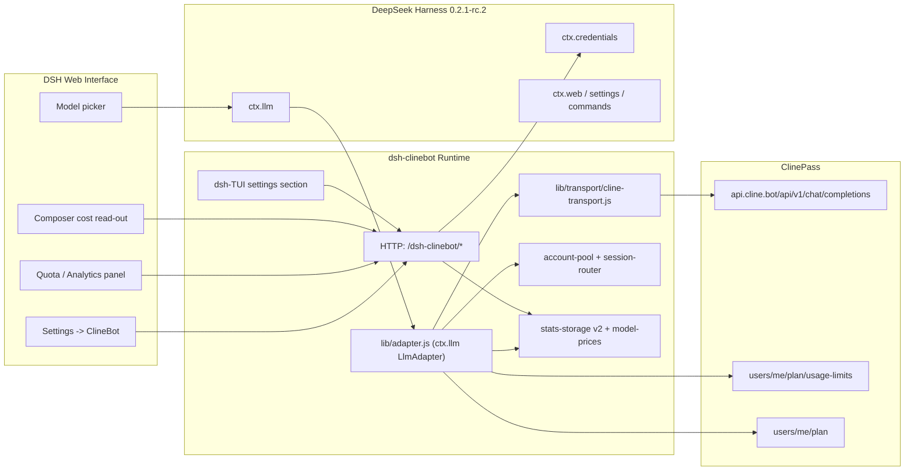
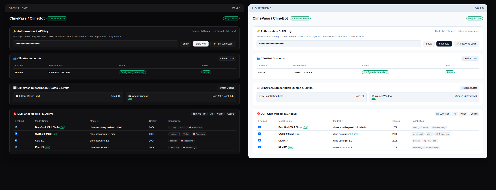

# 📦 @goodandready/dsh-clinebot

<div align="center">

<h3>Native ClineBot / ClinePass Provider Companion for DeepSeek Harness</h3>

<p><b>0.6.0</b> moves chat onto a native <code>ctx.llm</code> adapter. Requires DSH <code>0.2.1-rc.2</code>. The legacy <code>llm-pi-ai</code> + loopback-proxy path remains available behind <code>transport: "pi-ai"</code> for one release.</p>

<p align="center">
  <a href="https://www.npmjs.com/package/@goodandready/dsh-clinebot"></a>
  <a href="LICENSE"></a>
  <a href="https://github.com/topics/dsh-plugin"></a>
  <a href="https://nodejs.org"></a>
</p>

<!-- Author Showcase Link -->
<p align="center">
  <a href="https://goodandready.app/"></a>
</p>

<p align="center">
  <a href="README.md"><b>🇬🇧 English</b></a> •
  <a href="README.ru.md"><b>🇷🇺 Русский</b></a> •
  <a href="README.zh.md"><b>🇨🇳 中文说明</b></a>
</p>

<table align="center">
  <tr>
    <td align="center">
      ⭐ <strong>If you like this plugin, please star it on GitHub</strong> — it shows me that the plugin is useful to you and motivates me to keep developing it.
      <br><br>
      🐛 <strong>If you find a bug or would like to request a feature</strong>, open a GitHub issue in any language — I will review your proposal and implement useful suggestions in a future plugin version.
    </td>
  </tr>
</table>

</div>

---

## ⚡ Overview & The Problem

**ClinePass** (`https://cline.bot`) is a subscription service providing developers with 2–5x higher rate limits across premier open-weights coding and reasoning models through a single OpenAI-compatible endpoint (`https://api.cline.bot/api/v1`).

Integrating ClinePass into DeepSeek Harness (DSH) natively poses key challenges:
1. **No `/v1/models` Discovery**: `GET /v1/models` on `api.cline.bot` returns `404 Not Found`. Dynamic discovery fails silently or leaves the provider with 0 models.
2. **Model Identifier Formats**: Models require the specific prefix `cline-pass/` (e.g. `cline-pass/deepseek-v4.1-flash`, `cline-pass/kimi-k3`).
3. **Quota Tracking**: Rolling 5-hour and weekly limits need clear in-browser visualization.
4. **Credential Security**: Storing API keys directly in plain settings is insecure.

**`@goodandready/dsh-clinebot`** provides a complete solution:
* 🚀 **One-Click In-App Updater**: Upgrade `@goodandready/dsh-clinebot` directly from the DSH UI or trigger secure loopback updates via `/dsh-clinebot/update`.
* ⚡ **SWR Quota & Health Caching**: Instantaneous response time (<2ms) on status queries with background revalidation.
* 🔀 **Smart Quota-Aware Failover**: Automatic multi-account rotation on stream HTTP 429 and exhausted quota (with 30s storm protection; current request is not retried, subsequent chat requests use the next available account).
* 🖥️ **Plugin configuration page**: Open the installed ClineBot plugin and choose configure. The page shows the credential name, models, quota, and accounts. It is not a separate sidebar section.
* 🔄 **Dynamic Subscription Model Sync**: Automatically pulls real models included in your ClinePass plan directly from `GET /api/v1/users/me/plan` with one-click DSH provider sync. Only actual plan models are registered in DSH, while the built-in catalog serves as a rich properties reference and fallback when unsynced.
* ⚠️ **Quota Exhaustion Alerts**: Real-time visual warning banners when 5-hour rolling limit reaches 80% (warning) and 95% (exhausted), complete with countdown to reset.
* 📈 **Session Metrics Telemetry**: Live dashboard tracking real in-flight DSH chat requests through the ClineBot provider, prompt and completion tokens, stream latency, and error counts since process startup.
* 📊 **Live Quota Dashboard**: Visual progress bars for 5-hour rolling limits and weekly windows from the official `GET /users/me/plan/usage-limits` API.
* 🔑 **In-UI Key Storage**: Paste your API key directly in the UI; it is saved securely via `ctx.credentials.set()` into `~/.dsh/.credentials.yaml`.
* 🎯 **Model Picker Management**: Granular checkboxes to choose which models appear in the chat picker.
* 💬 **Slash-Command `/cline`**: Check quota, limits, warnings, session metrics, latency, and active model directly from the DSH chat console.

---

## 🏛️ Architecture



---

## ✨ Features & Module Breakdown

* **`lib/adapter.js`**:
  Registers the `ClineBotAdapter` directly on `ctx.llm`: streaming, model catalogue, reasoning effort, pre-first-token account failover, retry policy, usage accounting and provider metadata.
* **`lib/transport/cline-transport.js`**:
  OpenAI-compatible SSE transport with connect/idle timeouts, abort handling and upstream error classification. The legacy proxy imports the same parser.
* **`lib/models.js`**:
  Dynamic subscription catalogue, curated fallback properties, reasoning efforts, custom models and plan parsing (`parsePlanIncludedModels`, `getAllModels`, `getDynamicModels`).
* **`lib/model-prices.js`**:
  Explicit local cost estimates with per-model overrides. Unknown models stay `unpriced` instead of being reported as $0.
* **`lib/stats-storage.js`**:
  Persistent JSON telemetry v2: cache buckets, estimated cost, TTFT/latency, sessions and day/month/model/account aggregates. v1 files upgrade on read.
* **`lib/account-pool.js` / `lib/session-router.js`**:
  Credential discovery, usage-aware least-used and round-robin rotation, sticky sessions and cooldown recovery.
* **`lib/cline-client.js`**:
  `fetchUsageLimits`, credential save, smoke test, model cache and the legacy `llm-pi-ai` provider builder used only by `transport: "pi-ai"`.
* **`lib/index.js`**:
  Cordis lifecycle: adapter registration, optional HTTP routes, quota warnings, `/cline` command, migration of the legacy provider and TUI section registration.
* **`lib/tui-settings.js`**:
  `dsh-TUI` section for key, base URL, model filters, active account, context window and output cap.
* **`lib/client.js`**:
  Native `settings.section` plus provider card, sidebar meter, center-column quota/analytics panel (modal fallback) and composer cost read-out. No emojis, no full-page panel swap.

---

## 📦 Installation

```bash
dsh plugin --profile web add @goodandready/dsh-clinebot
```

Requires **DSH `0.2.1-rc.2`** and Node 22+. New installs use `transport: "adapter"` and register directly with `ctx.llm`. Set `transport: "pi-ai"` only if you still need the legacy `llm-pi-ai` provider and loopback proxy for one release.

Restart your DeepSeek Harness instance and refresh the browser.

### 0.6.0 endpoints

| Endpoint | Purpose |
| --- | --- |
| `GET /dsh-clinebot/analytics?groupBy=model\|day\|session&from=&to=` | Aggregated requests, tokens, estimated cost, success rate and TTFT |
| `GET /dsh-clinebot/prices` | Local price table used by the composer read-out |
| `GET /dsh-clinebot/accounts/usage` | Per-account quota snapshot |
| `GET /dsh-clinebot/stats/export?detailed=1` | CSV with cache, cost, TTFT and latency columns |

---

## 💬 Slash-Command `/cline`

From any DSH chat session, type `/cline` to inspect quota, warning alerts, and session telemetry:

```text
### 🤖 ClinePass Status (ClinePass)
* Latency: ✅ 210 ms
* Active Key: CLINEBOT_API_KEY (credentials)
* Default Model: `cline-pass/deepseek-v4.1-flash`

⏱ 5-Hour Window: [████░░░░░░] 42% (resets: 18:00)
📅 Weekly Window: [██████░░░░] 60% (resets: Sep 8)
* Account: `developer@example.com`

📈 Session Metrics:
* Requests: 14 calls
* Tokens: ~8,450 (Prompt: 6,100 | Completion: 2,350)
* Last Latency: 210 ms
```

---

## ⚙️ Configuration Reference (DSH Settings & Web UI)

In modern DeepSeek Harness (0.1.7+), settings are managed natively via the DSH Web UI Settings card or `PUT /dsh-clinebot/config`, with API keys persisted securely in DSH Credentials storage (`~/.dsh/.credentials.yaml`).

```yaml
dsh-clinebot:
  enabled: true
  baseUrl: https://api.cline.bot/api/v1
  apiKeyEnv: CLINEBOT_API_KEY
  defaultModel: your-default-model
  proxyMode: true
  disabledModels: []
  customModels: []
  modelReasoningDefaults:
    your-reasoning-model: high
  modelContextOverrides: []
  statsPath: ~/.dsh/clinebot-stats.json
  timeoutMs: 30000
  smokeTimeoutMs: 60000
  streamIdleTimeoutMs: 60000
  accounts:
    - label: Team Key
      apiKeyEnv: CLINEBOT_API_KEY_2
```

### Configuration Parameters

| Parameter | Type | Default | Description |
|:---|:---|:---|:---|
| `enabled` | `boolean` | `true` | Enable or disable the ClineBot provider bridge in DSH |
| `baseUrl` | `string` | `"https://api.cline.bot/api/v1"` | ClinePass OpenAI-compatible base URL |
| `apiKeyEnv` | `string` | `"CLINEBOT_API_KEY"` | Environment variable / credentials key name |
| `defaultModel` | `string` | `"cline-pass/deepseek-v4.1-flash"` | Default selected model ID for chat and smoke tests |
| `disabledModels` | `array` | `[]` | List of model IDs hidden from the DSH chat picker (new subscription models are auto-enabled) |
| `customModels` | `array` | `[]` | User-defined gateway models (`[{ id, name, contextLength, maxTokens, category, isReasoning }]`) |
| `modelReasoningDefaults` | `object` | `{}` | Configured default reasoning effort per model (`low`, `medium`, `high`, `max`) |
| `modelContextOverrides` | `array` | `[]` | User-defined model context length and max token overrides |
| `proxyMode` | `boolean` | `true` | Enable local transparent loopback proxy for sticky sessions and automatic 429 failover |
| `statsPath` | `string` | `"~/.dsh/clinebot-stats.json"` | Persistent on-disk path for token usage analytics |
| `accounts` | `array` | `[]` | Additional accounts for multi-account failover and quota rotation (`[{ label, apiKeyEnv }]`) |
| `activeAccount` | `string` | `""` | Manually pinned active account env name (empty for least-used auto routing) |
| `timeoutMs` | `number` | `15000` | HTTP probe timeout in milliseconds |
| `smokeTimeoutMs` | `number` | `25000` | Timeout for smoke test chat completions in milliseconds |
| `streamIdleTimeoutMs` | `number` | `30000` | Idle timeout between SSE stream chunks in milliseconds |
| `enabledModels` | `array` | *(deprecated)* | Read-only in public config; rejected on `PUT /config` in favor of `disabledModels` |
| `dynamicModels` | `array` | `[]` | Dynamic models automatically synced from the official plan |

---

## 🌐 HTTP API Endpoints

All endpoints are registered under `/dsh-clinebot/*` and protected against untrusted cross-site origins (same-origin and loopback allowed). Control endpoints enforce a 256 KiB request payload limit; the loopback proxy endpoint supports up to 64 MiB payloads (`MAX_PROXY_BODY_BYTES`):

### Management & Control Endpoints (Max 256 KiB)
* `GET /dsh-clinebot/status` — Live status report including provider health, active credential, quota, and session metrics.
* `GET /dsh-clinebot/config` — Diagnostic endpoint returning public configuration without secret keys.
* `PUT /dsh-clinebot/config` — Update configuration fields. Accepts only known schema properties (unknown fields or deprecated `enabledModels` return `400 Bad Request`).
* `POST /dsh-clinebot/key/verify` — Validates a candidate API key against `api.cline.bot` and returns account email and plan name.
* `POST /dsh-clinebot/save-key` — Saves a key into DSH credentials service under a valid `CLINEBOT_API_KEY*` name.
* `POST /dsh-clinebot/models/sync` — Synchronizes models with your active subscription plan.
* `POST /dsh-clinebot/models/toggle` — Toggles models via `disabledModels` (atomic Volatile preservation).
* `POST /dsh-clinebot/models/custom` / `DELETE /dsh-clinebot/models/custom` — Manage custom user-defined models.
* `POST /dsh-clinebot/models/context` / `DELETE /dsh-clinebot/models/context` — Manage model context length overrides.
* `POST /dsh-clinebot/accounts` — Add account to the multi-account pool.
* `POST /dsh-clinebot/accounts/delete` — Delete account from the pool with atomic credential preservation.
* `POST /dsh-clinebot/accounts/active` — Switch or pin active account (or empty for auto least-used routing).
* `POST /dsh-clinebot/stats/reset` — Reset session request and token statistics.
* `POST /dsh-clinebot/smoke` — Runs a live latency test ping.
* `GET /dsh-clinebot/update/status` — Query available GitHub releases and plugin updates.
* `POST /dsh-clinebot/update/apply` — Apply version upgrade with process-group cleanup and lockfile sync.

### OpenAI-Compatible Loopback Proxy (Max 64 MiB)
* `POST /dsh-clinebot/v1/chat/completions` — Transparent local proxy supporting streaming SSE and non-streaming responses, Bearer token authentication, sticky session affinity with least-used quota allocation, body read watchdog (`streamIdleTimeoutMs`), and automatic 429 failover.
* `GET /dsh-clinebot/v1/models` — OpenAI-compatible catalog listing all active plan and custom models.

> **DSH Desktop 2.x & Headless Environments**: The loopback proxy binds an isolated loopback HTTP server on `127.0.0.1` (ephemeral port), completely bypassing `DesktopWebServer` renderer fences (`x-dsh-desktop-renderer`). Automated fence detection (`detectHostWebServerFence`) falls back to direct upstream connection if the loopback server is restricted, and proxy mode can be directly toggled via the Diagnostics settings card.

---

## Visual verification

Settings card in DeepSeek Harness, Dark and Light themes side by side:



---

## 🧪 Testing

Run the automated test suite:

```bash
npm test
```

---

## 📄 License

MIT © [GooDAnDReaDY](https://github.com/GooDAnDReaDY)
